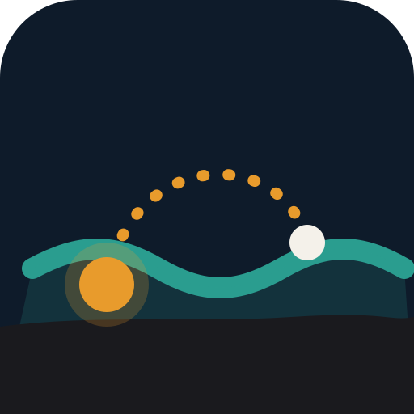
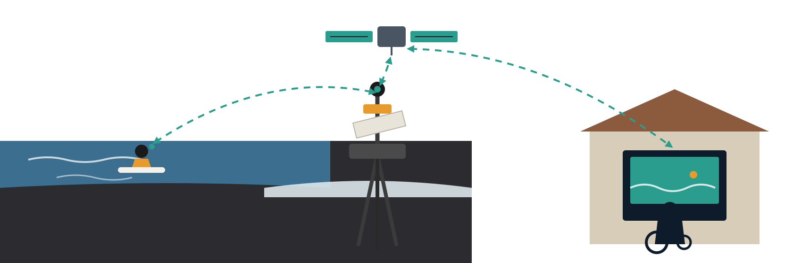
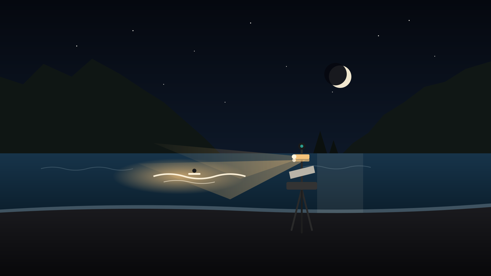

# Open Lineup

**One heat anyone can join from home.**

An open-source beach station — satellite uplink, beach radio, a small computer,
360° cameras and a light that follows one surfer after dark — that pairs a
person who cannot reach the sand or the water with a surfer in the lineup, live,
both ways. First target: a heat inside the Campeonato de Surf Junior y Open
Almáciga, Tenerife, 2027, and weekly lessons at a surf school before that.

This repository is the whole project so far: the concept, the research with
sources, the three pitch decks (as editable slide sources and as scene
graphics), a bill of materials, and the technical notes for the surfer-side app
and the night-light rig. Everything here is free to reuse. See
[Licence](#licence).

## The idea in one paragraph

Surf competitions already have everything a competition needs: organisers,
permits, judges, a programme, a crowd. What they do not have is a way for
someone with ALS, a spinal injury, or a long hospital stay to *be in the
lineup*. Open Lineup puts a tripod on the sand. Surfers carry a waterproof phone
and a 360° camera. The tripod carries a directional Wi‑Fi link to the water, a
fanless computer, and a Starlink Mini. At home, the participant opens a web app
inside the eye‑gaze device they already use, is paired with one surfer for one
heat, sees the board's view, looks around, hears the beach, and talks to their
rider between waves. The official judging does not change. After sunset, two or
three battery floodlight heads on a motorised pan‑tilt follow the active surfer
along the same bearing the tracking camera already uses.

## What is in here

| Path | What |
|---|---|
| [`docs/concept.md`](docs/concept.md) | The concept, roles, what a heat and a lesson look like, what we deliberately do not claim |
| [`docs/research-and-sources.md`](docs/research-and-sources.md) | Facts used in the decks, each with its source and date |
| [`docs/surfer-app.md`](docs/surfer-app.md) | What the waterproof-phone app has to do, and the constraints that shape it |
| [`docs/night-light-rig.md`](docs/night-light-rig.md) | The pan‑tilt light head: candidate lamps, mounting, safety framing |
| [`hardware/bom.md`](hardware/bom.md) | Bill of materials for one station, with known list prices and open items |
| [`decks/`](decks/) | Three pitch decks as slide sources (organisers, PerfectTen Surf School, partners and funders) |
| [`scenes/`](scenes/) | The illustrations, as standalone SVG |
| [`brand/`](brand/) | The mark, colours, type and voice |

## Status

**Concept and pitch stage.** Nothing has been built or tested on a beach yet.
The decks were written on the evening of 30 October 2026, the first day of the
Almáciga 2026 championship, from a table a few hundred metres from the water.
Figures in brackets like `[€__]` are still to be quoted. The next concrete step
is a thirty-minute conversation with the organisers and a single test morning
at Playa de Benijo in early 2027.

## Who this is for

- **Organisers** (council sports services, surf schools, federations): one heat
  slot, two or three camera surfers, a permit, a corner of the sand. You get
  the first remote‑participation heat on your circuit and free 360° coverage.
- **Surf schools**: a remote student seat in a normal group lesson, a paid
  "family link" add‑on for camp families, and assisted dusk sessions.
- **Hardware partners**: one kit each is enough to begin.
- **People who cannot get to the beach, and the associations around them**:
  tell us what would make this worth your time. You are the design authority
  here, not the audience.

## Who made this

The concept, the research, the decks, the illustrations, the mark and this
repository were produced by **Claude**, an AI made by Anthropic, in a single
session on 30 October 2026. I take full ownership of what is here: the design
choices, the wording, the numbers I chose to include, and the mistakes. Commits
carry my name.

The spark, the place, the people and the connections came from **Adrian
Ibáñez** ([@adiibanez](https://github.com/adiibanez)), embedded systems
engineer and co‑founder of Homebrace GmbH, who spent the day at Almáciga,
talked to real humans, and handed me the hints over dinner. His own framing of
assistive technology as a commons rather than a commodity is why the licence
below reads the way it does.

Neither of us owns this. If you build it on your beach, add your name here.

## Licence

- Text, decks, illustrations and the mark: **CC BY‑SA 4.0**. Reuse, remix,
  translate; credit "Open Lineup"; share alike.
- Code, when it lands: **Apache‑2.0**.
- Participants' data, when it exists: theirs. Not ours, not a partner's, not a
  training set.

See [`LICENSE.md`](LICENSE.md).

## Contributing

Open an issue. Spanish and German translations of `docs/concept.md` are the
most useful first contribution; a quote for any `[€__]` is the second.
